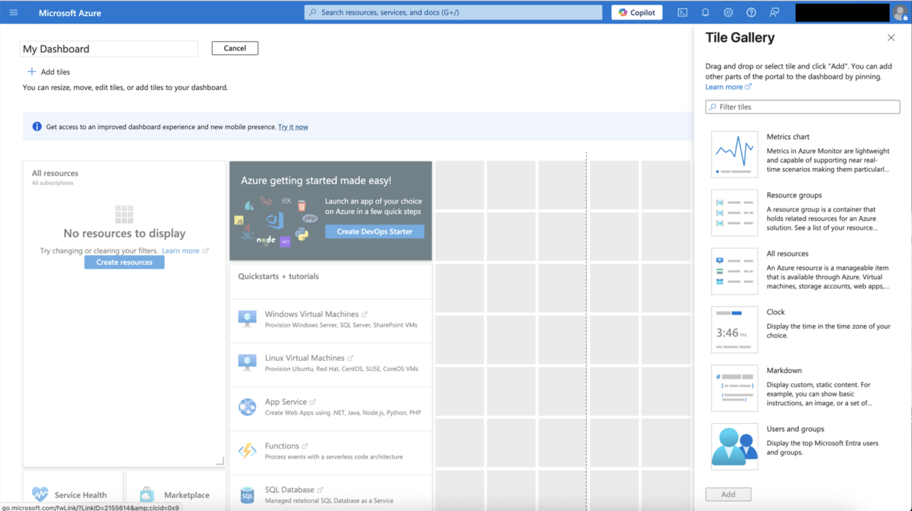
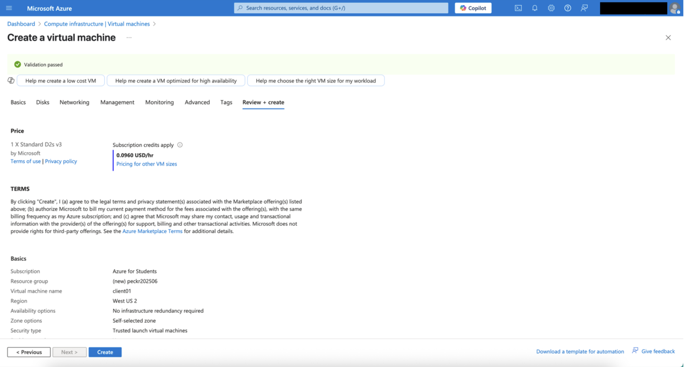
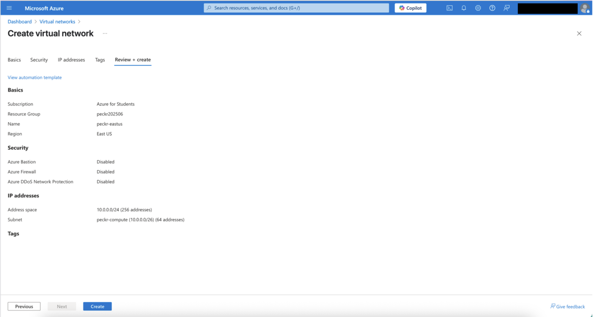
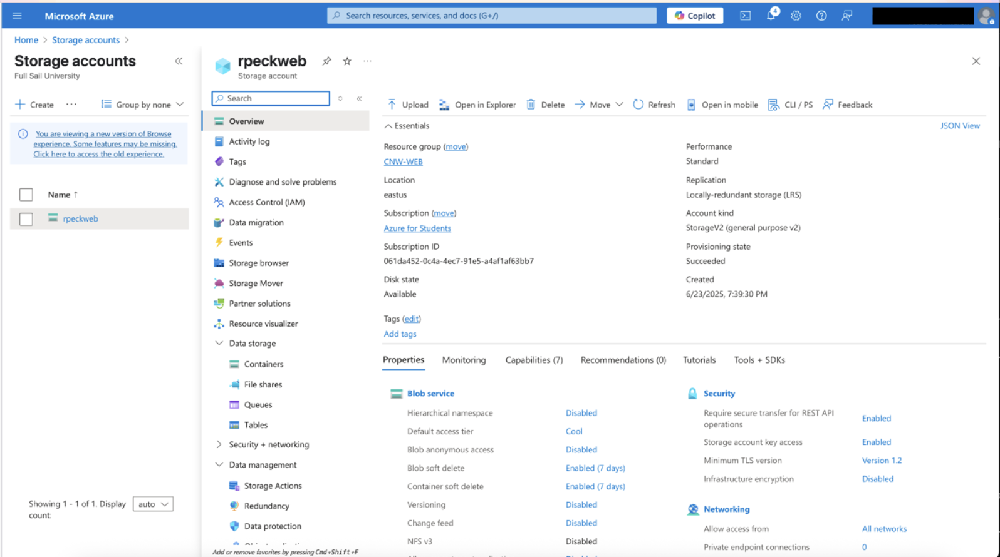
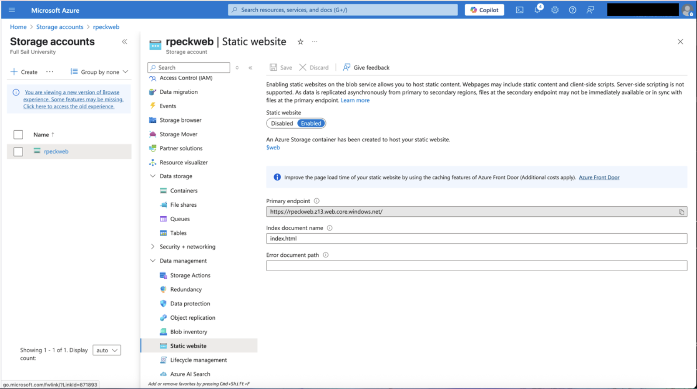
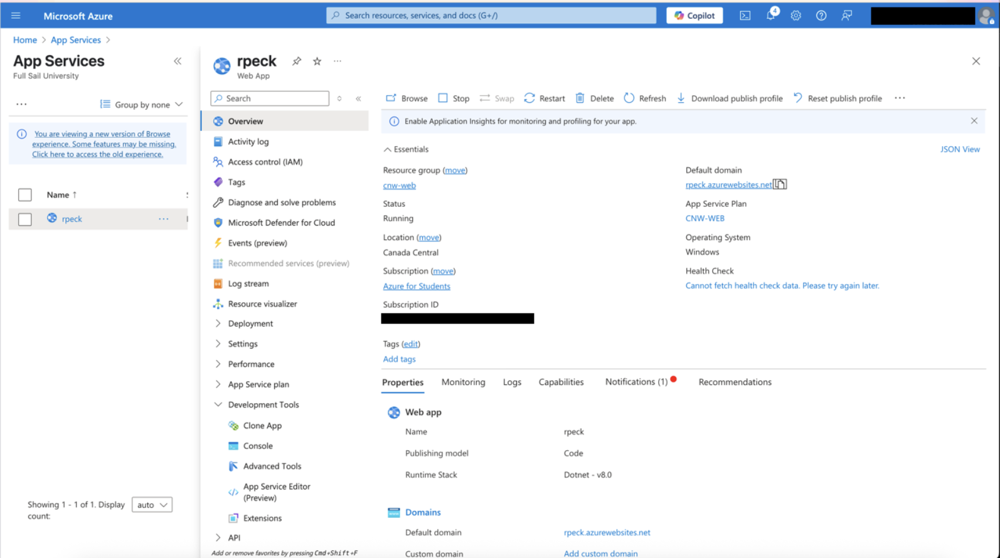

# Azure Cloud Infrastructure Lab

## Project Overview

This project focused on building and managing cloud resources in Microsoft Azure.

The lab covered Azure portal navigation, virtual machine deployment, virtual networking, storage accounts, static website hosting, App Services, security-related cloud settings, pricing awareness, and resource cleanup.

The goal was to gain hands-on experience with common Azure services while learning how cloud compute, networking, storage, and application hosting fit together in a practical environment.

## Objectives

- Navigate and customize the Microsoft Azure portal.
- Configure a virtual machine in Azure.
- Review VM sizing, regional deployment, pricing, and security options.
- Create and configure an Azure virtual network and subnet.
- Review cloud networking and security controls.
- Configure an Azure Storage Account.
- Enable Azure static website hosting.
- Review storage security and networking settings.
- Explore Azure App Service.
- Understand cloud resource lifecycle management and cleanup.

## Tools & Technologies

- Microsoft Azure
- Azure Portal
- Azure Virtual Machines
- Azure Virtual Networks
- Azure Storage Accounts
- Azure Static Website Hosting
- Azure App Service
- Network Security Groups
- Azure Firewall concepts
- Azure DDoS Protection concepts
- Microsoft Defender for Cloud
- Azure Cloud Shell / Azure CLI concepts
- Windows-based cloud workloads

## Azure Portal and Resource Management

The Azure portal was used as the primary management interface for working with cloud resources.

The dashboard provides centralized access to services such as virtual machines, virtual networks, storage accounts, security tools, and resource groups.

*Microsoft Azure dashboard configuration showing access to cloud resources, services, and management tools.*

## Virtual Machine Configuration

A virtual machine was configured through the Azure deployment workflow.

The configuration included resource group placement, VM naming, region selection, VM size, pricing review, and Trusted Launch security.

*Azure virtual machine configuration at the Review + Create stage after deployment validation passed.*

The selected VM used the Standard D2s v3 size, which provides a balance of compute and memory suitable for general-purpose workloads.

The lab also introduced the importance of considering both performance requirements and ongoing cloud cost when selecting infrastructure.

## Virtual Network Configuration

A virtual network was created to provide an isolated network environment for Azure resources.

The network design included:

- Address space: `10.0.0.0/24`
- Compute subnet: `10.0.0.0/26`
- Regional deployment
- Review of Azure Bastion
- Review of Azure Firewall
- Review of Azure DDoS Network Protection

*Azure virtual network configuration showing address space, subnet design, region, and available security options.*

Virtual networks provide the foundation for communication between Azure resources while allowing administrators to control segmentation, routing, and access.

## Storage Account Configuration

An Azure Storage Account was configured to provide cloud-based storage services.

The Storage Account overview included configuration for:

- StorageV2 account type
- Standard performance
- Locally redundant storage
- Blob services
- Secure transfer
- TLS requirements
- Soft delete
- Networking access

*Azure Storage Account overview showing replication, blob configuration, security settings, TLS requirements, and networking access.*

The configuration demonstrated that cloud storage includes both availability and security considerations rather than simply providing remote disk space.

## Static Website Hosting

Azure Storage was also used to host static web content.

Static website hosting was enabled on the Storage Account, which automatically created the `$web` container used to store website files.

The index document was configured as:

`index.html`

*Azure Storage static website configuration showing the enabled web endpoint, `$web` container, and index document.*

This demonstrated how cloud storage can also be used as a lightweight web-hosting platform for static content.

## Azure App Service

The lab also included Azure App Service, a managed platform for hosting web applications.

The App Service overview showed the application running on a Windows environment with a .NET runtime and an Azure-provided web domain.

*Azure App Service overview showing the running web application, hosting plan, region, operating system, and application runtime.*

Using a managed application platform reduces the amount of underlying server administration required compared with deploying and maintaining a full virtual machine.

## Cloud Security Considerations

Several Azure security concepts were reviewed throughout the project.

These included:

- Network Security Groups
- Azure Firewall
- DDoS protection
- Trusted Launch virtual machines
- Secure storage transfer
- TLS configuration
- Microsoft Defender for Cloud
- Identity and Access Management
- Resource-level access control

Cloud security follows a shared-responsibility model where both the cloud provider and the customer have security responsibilities.

Administrators must still correctly configure identities, networking, storage permissions, security controls, and exposed services.

## Cost Awareness

Cloud infrastructure introduces a usage-based pricing model.

The project included reviewing estimated virtual machine pricing and examining the costs associated with Azure services such as:

- Virtual machines
- Public IP addresses
- Azure Firewall
- Storage
- Application hosting

This reinforced the importance of monitoring resource usage and removing resources that are no longer required.

## Resource Cleanup

After completing the lab activities, temporary Azure resources were removed.

Cleaning up unused cloud resources is important because many Azure services continue generating charges while they remain provisioned.

The project reinforced the importance of managing the full resource lifecycle:

**Provision → Configure → Test → Monitor → Remove**

## Key Takeaways

- Azure provides centralized management for compute, networking, storage, and applications.
- Virtual machines require planning around performance, region, cost, and security.
- Virtual networks provide logical segmentation for cloud resources.
- Cloud storage includes important security and redundancy settings.
- Static websites can be hosted directly from Azure Storage.
- App Service provides managed application hosting without requiring full server administration.
- Security settings should be reviewed during deployment rather than after resources are already exposed.
- Resource cleanup is an important part of cloud administration and cost management.

## Skills Demonstrated

- Microsoft Azure administration
- Cloud resource provisioning
- Virtual machine configuration
- Virtual networking
- Subnet planning
- Azure Storage administration
- Static website hosting
- Azure App Service
- Cloud security concepts
- Resource lifecycle management
- Cost awareness
- Infrastructure documentation
- Cloud troubleshooting

## Lab Disclaimer

This project was completed in an authorized educational Microsoft Azure environment.

All resources were created for training purposes. Account identifiers, subscription information, and other sensitive details were redacted from screenshots before publication.